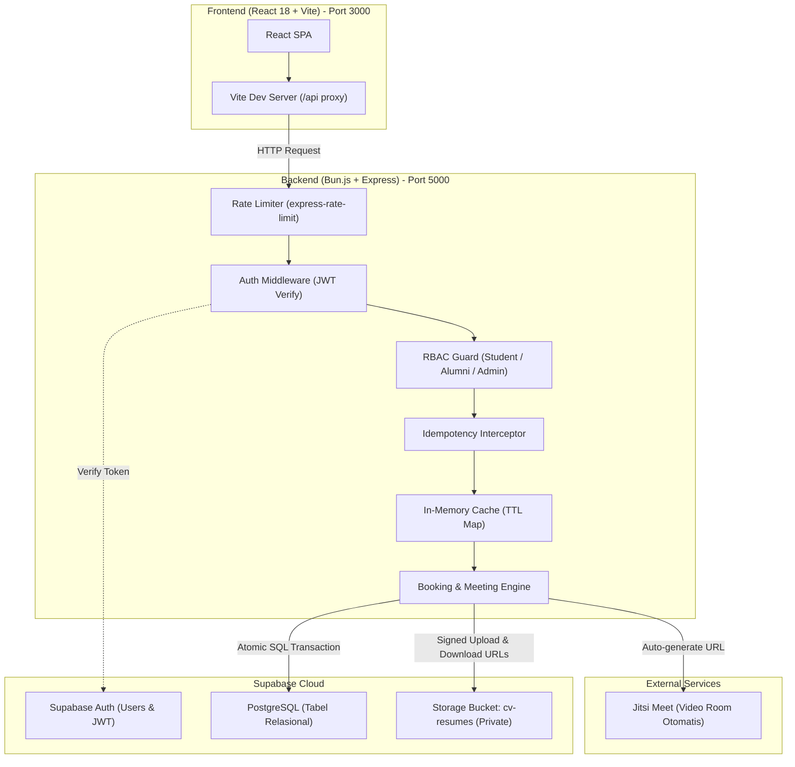

# KoneksiAlumni — Micro-Mentorship Platform

Platform micro-mentorship yang menghubungkan mahasiswa aktif dengan alumni terverifikasi untuk sesi 1-on-1: **Review CV**, **Technical Mock Interview**, dan **Career Consultation** (durasi 15–45 menit).

Dibangun dengan arsitektur **monorepo**:
- **Backend:** Express.js yang berjalan di atas runtime **Bun.js (TypeScript)**.
- **Database & Auth:** **Supabase** (PostgreSQL, Supabase Auth JWT, dan Private Storage Bucket).
- **Frontend:** **React 18 + Vite + TypeScript**.

> [!TIP]
> **Baru pertama kali menggunakan Supabase?**
> Ikuti panduan visual langkah-demi-langkah dari nol di **[SETUP_GUIDE.md](SETUP_GUIDE.md)** (mulai dari pendaftaran akun, pembuatan database di cloud, setup bucket privat, hingga uji coba end-to-end).

---

## Daftar Isi
1. [Arsitektur Sistem](#arsitektur-sistem)
2. [Prasyarat Sistem](#prasyarat-sistem)
3. [Panduan Instalasi & Setup](#panduan-instalasi--setup)
4. [Konfigurasi Environment (.env)](#konfigurasi-environment-env)
5. [Skema Database (PostgreSQL)](#skema-database-postgresql)
6. [Mekanisme Rekayasa (Engineering Highlights)](#mekanisme-rekayasa-engineering-highlights)
   - [Pencegahan Race Condition (Atomic Locking)](#1-pencegahan-race-condition-atomic-locking)
   - [Idempotency Guard](#2-idempotency-guard)
   - [Multi-tier Rate Limiting](#3-multi-tier-rate-limiting)
   - [In-Memory TTL Caching](#4-in-memory-ttl-caching)
   - [Keamanan Dokumen CV (Signed URL)](#5-keamanan-dokumen-cv-signed-url)
7. [Dokumentasi REST API](#dokumentasi-rest-api)
8. [Pengujian Otomatis (Testing)](#pengujian-otomatis-testing)
9. [Troubleshooting & FAQ](#troubleshooting--faq)

---

## Arsitektur Sistem



---

## Prasyarat Sistem

Pastikan environment Anda telah memiliki:
- **Bun Runtime:** versi `>= 1.0.0` (proyek ini diuji pada Bun `1.4.4`).
- **Akun Supabase:** project aktif di [supabase.com](https://supabase.com).
- **Node.js (Opsional):** tidak wajib, seluruh script dapat dijalankan penuh via Bun CLI.

---

## Panduan Instalasi & Setup

### 1. Clone & Masuk Direktori
```bash
git clone <repository-url>
cd koneksi-alumni
```

### 2. Setup Database Supabase
1. Buka dashboard proyek Supabase Anda $\rightarrow$ masuk ke menu **SQL Editor**.
2. Salin isi file [`backend/sql/schema.sql`](backend/sql/schema.sql) lalu jalankan (**Run**). Ini akan membuat enums, 6 tabel relasional, tabel idempotency, dan indeks performa.
3. Salin isi file [`backend/sql/seed.sql`](backend/sql/seed.sql) lalu jalankan (**Run**) untuk mengisi data awal topik mentorship (Frontend, Backend, AI/ML, UI/UX, dll).

### 3. Setup Supabase Storage (Wajib untuk Fitur CV)
1. Di dashboard Supabase, buka menu **Storage** $\rightarrow$ klik **New Bucket**.
2. Beri nama bucket: `cv-resumes`.
3. **PENTING:** Biarkan opsi **Public Bucket** dalam keadaan **OFF / Disabled** (bucket harus berstatus private).

### 4. Setup Backend
```bash
cd backend
cp .env.example .env
# Edit file .env dan masukkan URL serta Service Role Key Supabase Anda
bun install
bun run dev
```
Backend akan aktif di `http://localhost:5000`.

### 5. Setup Frontend
Buka terminal baru:
```bash
cd frontend
bun install
bun run dev
```
Frontend akan aktif di `http://localhost:3000` (otomatis mem-proxy request `/api/*` ke port 5000).

---

## Konfigurasi Environment (.env)

### Backend: `backend/.env`
| Variabel | Tipe | Wajib | Keterangan |
|---|---|:---:|---|
| `PORT` | `number` | Tidak | Port HTTP server backend (default: `5000`). |
| `NODE_ENV` | `string` | Tidak | `development` atau `production`. |
| `SUPABASE_URL` | `string` | **Ya** | Project URL dari Supabase (contoh: `https://xxxx.supabase.co`). |
| `SUPABASE_SERVICE_ROLE_KEY` | `string` | **Ya** | Service Role Secret Key (diambil dari menu *Settings* $\rightarrow$ *API* $\rightarrow$ *service_role secret*). Digunakan backend untuk bypass RLS pada transaksi terverifikasi. |

> [!CAUTION]
> Jangan pernah mengekspos `SUPABASE_SERVICE_ROLE_KEY` ke sisi frontend atau repository publik!

---

## Skema Database (PostgreSQL)

Skema database dirancang secara **lean** (tanpa field dekoratif yang tidak terpakai di endpoint bisnis):

```
profiles
├── id (UUID, PK) -> references auth.users(id) ON DELETE CASCADE
├── role (ENUM: 'student', 'alumni', 'admin')
├── full_name (VARCHAR 150)
├── university_email (VARCHAR 150, UNIQUE)
├── bio (TEXT, nullable)
├── current_company (VARCHAR 100, alumni only)
├── current_position (VARCHAR 100, alumni only)
├── linkedin_url (VARCHAR 255, nullable)
├── is_verified (BOOLEAN, default false untuk alumni, true untuk student)
└── created_at (TIMESTAMPTZ)

topics
├── id (SERIAL, PK)
└── name (VARCHAR 50, UNIQUE)

alumni_topics
├── alumni_id (UUID, FK -> profiles.id)
└── topic_id (INT, FK -> topics.id)
└── PRIMARY KEY (alumni_id, topic_id)

mentorship_slots
├── id (UUID, PK, default gen_random_uuid())
├── alumni_id (UUID, FK -> profiles.id)
├── session_type (ENUM: 'mock_interview', 'cv_review', 'career_sharing')
├── start_time (TIMESTAMPTZ)
├── end_time (TIMESTAMPTZ)
├── status (ENUM: 'available', 'booked', 'cancelled')
└── created_at (TIMESTAMPTZ)

bookings
├── id (UUID, PK, default gen_random_uuid())
├── slot_id (UUID, FK -> mentorship_slots.id, UNIQUE)
├── student_id (UUID, FK -> profiles.id)
├── notes (TEXT, nullable)
├── cv_file_path (TEXT, nullable)
├── meeting_url (TEXT)
├── status (ENUM: 'confirmed', 'completed', 'cancelled')
└── created_at (TIMESTAMPTZ)

reviews
├── id (UUID, PK)
├── booking_id (UUID, FK -> bookings.id, UNIQUE)
├── student_id (UUID, FK -> profiles.id)
├── alumni_id (UUID, FK -> profiles.id)
├── rating (INT, CHECK 1-5)
├── comment (TEXT, nullable)
└── created_at (TIMESTAMPTZ)

idempotency_keys
├── key (VARCHAR 255, PK)
├── response (JSONB)
└── created_at (TIMESTAMPTZ)
```

---

## Mekanisme Rekayasa (Engineering Highlights)

### 1. Pencegahan Race Condition (Atomic Locking)
Masalah umum: Dua mahasiswa menekan tombol booking pada slot yang sama di milidetik yang sama.
**Solusi:** Backend tidak menggunakan pola rentan `SELECT` lalu `UPDATE`, melainkan menjalankan **Atomic Conditional Update** langsung di PostgreSQL:

```typescript
const { data: slot, error } = await supabase
  .from('mentorship_slots')
  .update({ status: 'booked' })
  .eq('id', slotId)
  .eq('status', 'available')
  .select('*')
  .single();

if (!slot) {
  // Transaksi kedua otomatis mendapati status bukan 'available' -> ditolak 409 Conflict
  throw { status: 409, message: 'Slot sudah dipesan atau tidak lagi tersedia.' };
}
```

### 2. Idempotency Guard
Jika koneksi internet klien terputus sesaat setelah menekan tombol pesan, klien mungkin akan mengirim ulang request (`retry`).
- Frontend menyertakan header: `Idempotency-Key: <unique-uuid>`.
- Middleware `idempotencyCheck` memeriksa tabel `idempotency_keys`.
- Jika key sudah pernah diproses dalam kurun waktu `< 24 jam`, backend langsung mengembalikan respons cache yang identik tanpa membuat booking ganda atau mengunci slot lain.

### 3. Multi-tier Rate Limiting
Menggunakan `express-rate-limit` untuk proteksi API dari spam bot dan abuse:
- **Global:** `100 request / 1 menit` per IP.
- **Booking Engine (`POST /api/bookings`):** `5 request / 1 menit` per IP.
- **Auth Sync (`POST /api/auth/profile`):** `10 request / 5 menit` per IP.

### 4. In-Memory TTL Caching
Untuk mengurangi query beban database yang berulang:
- `GET /api/alumni`: cache **5 menit** (auto-invalidation saat ada update profil/review).
- `GET /api/slots`: cache **30 detik** (auto-invalidation saat slot dibuat/dibooking/dibatalkan).
- `GET /api/topics`: cache **30 menit**.

### 5. Keamanan Dokumen CV (Signed URL)
- Dokumen CV mahasiswa tersimpan di private bucket (`cv-resumes`).
- Akses publik langsung diblokir di level storage.
- Alumni hanya dapat membaca file melalui endpoint `/api/storage/cv-url/:bookingId` yang menghasilkan **Signed URL dengan masa berlaku 60 menit (3600 detik)** setelah backend memverifikasi bahwa alumni yang login adalah pemilik sah slot tersebut.

---

## Dokumentasi REST API

Semua endpoint dilindungi oleh header autentikasi kecuali `GET /api/health`:
```http
Authorization: Bearer <supabase_access_token>
```

Format respons JSON standar:
```json
{
  "success": true,
  "message": "Deskripsi hasil",
  "data": { ... }
}
```

### 1. Sistem & Health
#### `GET /api/health`
Mengecek status server dan runtime.
```bash
curl -X GET http://localhost:5000/api/health
```
**Respons (200 OK):**
```json
{
  "success": true,
  "message": "KoneksiAlumni API is running",
  "data": {
    "runtime": "bun",
    "version": "1.0.0"
  }
}
```

---

### 2. Autentikasi & Profil Pengguna
#### `POST /api/auth/profile`
Sinkronisasi profil setelah user mendaftar/login di Supabase Auth.
```bash
curl -X POST http://localhost:5000/api/auth/profile \
  -H "Authorization: Bearer <TOKEN>" \
  -H "Content-Type: application/json" \
  -d '{
    "role": "alumni",
    "full_name": "Budi Hartono, S.Kom.",
    "university_email": "budi.alumni@kampus.ac.id",
    "current_company": "Tokopedia",
    "current_position": "Senior Backend Engineer",
    "bio": "Alumni angkatan 2019, fokus di microservices & system design.",
    "linkedin_url": "https://linkedin.com/in/budihartono"
  }'
```

#### `GET /api/auth/me`
Mengambil data profil milik user yang sedang login.

#### `PATCH /api/auth/profile`
Memperbarui field profil (`bio`, `current_company`, `current_position`, `linkedin_url`).

---

### 3. Direktori Alumni
#### `GET /api/alumni`
Mengambil daftar alumni yang sudah diverifikasi admin (`is_verified = true`).
- Query params:
  - `topic`: filter nama topik (contoh: `?topic=Backend`)
  - `company`: filter nama perusahaan (contoh: `?company=GoTo`)
  - `q`: pencarian nama atau posisi (contoh: `?q=Engineer`)

#### `GET /api/alumni/:id`
Mengambil detail satu alumni lengkap beserta topik keahlian dan review.

---

### 4. Slot Ketersediaan Alumni
#### `POST /api/slots` (Role: Alumni)
Alumni membuka ketersediaan jadwal mentoring.
```bash
curl -X POST http://localhost:5000/api/slots \
  -H "Authorization: Bearer <ALUMNI_TOKEN>" \
  -H "Content-Type: application/json" \
  -d '{
    "session_type": "mock_interview",
    "start_time": "2026-11-20T19:00:00.000Z",
    "end_time": "2026-11-20T19:45:00.000Z"
  }'
```

#### `GET /api/slots`
Melihat daftar slot yang masih berstatus `available`.
- Query params: `alumniId`, `date` (YYYY-MM-DD), `type` (`mock_interview` / `cv_review` / `career_sharing`).

#### `DELETE /api/slots/:id` (Role: Alumni)
Menghapus slot milik sendiri yang belum dipesan.

---

### 5. Pemesanan Mentoring (Bookings)
#### `POST /api/bookings` (Role: Student)
Memesan slot secara atomik dan meng-generate link video call Jitsi.
```bash
curl -X POST http://localhost:5000/api/bookings \
  -H "Authorization: Bearer <STUDENT_TOKEN>" \
  -H "Idempotency-Key: a4b5c6d7-1234-5678-9101-112131415161" \
  -H "Content-Type: application/json" \
  -d '{
    "slot_id": "018f3a5b-9d41-71b3-b452-67123456789a",
    "notes": "Ingin review coding test studi kasus Go microservices."
  }'
```
**Respons (201 Created):**
```json
{
  "success": true,
  "message": "Booking berhasil dibuat!",
  "data": {
    "id": "e2f1a3b4-5678-4321-abcd-9876543210ef",
    "slot_id": "018f3a5b-9d41-71b3-b452-67123456789a",
    "student_id": "c1a2b3d4-...",
    "meeting_url": "https://meet.jit.si/koneksi-alumni-e2f1a3b456784321abcd9876543210ef",
    "status": "confirmed",
    "created_at": "2026-11-10T13:30:00.000Z"
  }
}
```

#### `GET /api/bookings/my`
Mengambil riwayat sesi user saat ini (mahasiswa: daftar sesi yang dipesan; alumni: daftar sesi bimbingan yang masuk).

#### `PATCH /api/bookings/:id/cancel`
Membatalkan sesi dan mengembalikan status slot menjadi `available`.

#### `PATCH /api/bookings/:id/complete` (Role: Alumni)
Menandai sesi telah selesai sehingga mahasiswa dapat menulis ulasan.

---

### 6. Akses & Unggah Dokumen CV
#### `POST /api/storage/upload-url` (Role: Student)
Mendapatkan signed URL untuk mengunggah file CV langsung ke storage privat.
```bash
curl -X POST http://localhost:5000/api/storage/upload-url \
  -H "Authorization: Bearer <STUDENT_TOKEN>" \
  -H "Content-Type: application/json" \
  -d '{
    "file_name": "CV_Budi_2026.pdf",
    "booking_id": "e2f1a3b4-5678-4321-abcd-9876543210ef"
  }'
```

#### `GET /api/storage/cv-url/:bookingId` (Role: Alumni)
Menghasilkan temporary signed download URL (berlaku 60 menit) bagi alumni yang membimbing sesi tersebut.

---

### 7. Rating & Ulasan
#### `POST /api/reviews` (Role: Student)
Memberikan rating (1-5) dan komentar setelah sesi berstatus `completed`.
```bash
curl -X POST http://localhost:5000/api/reviews \
  -H "Authorization: Bearer <STUDENT_TOKEN>" \
  -H "Content-Type: application/json" \
  -d '{
    "booking_id": "e2f1a3b4-5678-4321-abcd-9876543210ef",
    "rating": 5,
    "comment": "Feedbacknya sangat mendalam dan langsung to-the-point ke celah arsitektur backend saya."
  }'
```

---

### 8. Panel Admin
| Method | Endpoint | Deskripsi |
|---|---|---|
| `GET` | `/api/admin/users?role=&verified=` | Daftar pengguna sistem. |
| `PATCH` | `/api/admin/verify/:userId` | Verifikasi status alumni agar tampil di pencarian publik. |
| `PATCH` | `/api/admin/users/:userId/role` | Mengubah role (`student`, `alumni`, `admin`). |
| `DELETE` | `/api/admin/users/:userId` | Menghapus akun pengguna dari database. |
| `GET` | `/api/admin/stats` | Agregat metrik: total pengguna, sesi completed/cancelled, rata-rata rating. |

---

## Pengujian Otomatis (Testing)

Proyek ini menggunakan test runner bawaan Bun (`bun test`). Pengujian mencakup fungsionalitas unit, error boundary, rate limiting rejection, dan in-memory cache lifecycle.

Jalankan test suite backend:
```bash
cd backend
bun test
```

Hasil pengujian:
```text
bun test v1.4.4
tests/health.test.ts:
✓ Health Check API > GET /api/health returns 200 and runtime info [74.90ms]

tests/cache.test.ts:
✓ In-Memory Cache Utility > should store and retrieve data within TTL [0.25ms]
✓ In-Memory Cache Utility > should return null for expired cache [61.95ms]
✓ In-Memory Cache Utility > should invalidate cache matching pattern prefix [0.48ms]

tests/auth_guard.test.ts:
✓ Auth Guard Middleware > GET /api/alumni should reject request without token with 401 [89.02ms]
✓ Auth Guard Middleware > POST /api/bookings should reject request without token with 401 [70.29ms]

tests/meeting.test.ts:
✓ Meeting Service > should generate a valid Jitsi Meet URL with clean alphanumeric room id [0.20ms]

 7 pass, 0 fail (Ran 7 tests across 4 files)
```

Untuk memeriksa konsistensi tipe TypeScript:
```bash
cd backend && bun x tsc --noEmit
cd ../frontend && bun run build
```

---

## Troubleshooting & FAQ

#### 1. Error: `SUPABASE_URL belum diatur` saat menjalankan server
Pastikan file `.env` di folder `backend/` sudah dibuat dari `.env.example` dan nilainya bukan string kosong.

#### 2. Error: `foreign key violation` saat memanggil `POST /api/auth/profile`
Tabel `profiles` memiliki relasi `id -> auth.users(id)`. Akun user harus terlebih dahulu terdaftar di Supabase Auth (misal melalui signup di frontend atau dashboard Supabase) sebelum memanggil endpoint sinkronisasi profil.

#### 3. Error saat upload CV: `Bucket not found`
Pastikan Anda sudah membuat bucket bernama `cv-resumes` di menu **Storage** Supabase. Secara default nama bucket ini *case-sensitive*.

#### 4. Kapan Alumni tampil di hasil pencarian `/api/alumni`?
Hanya alumni yang memiliki atribut `is_verified = true` yang akan muncul di direktori publik. Verifikasi dapat dilakukan via endpoint `PATCH /api/admin/verify/:userId` oleh akun admin kampus.

---

## Lisensi & Kontribusi
Proyek ini dilisensikan di bawah **[Apache License 2.0](LICENSE)**.

### Mengapa Apache 2.0?
Berbeda dengan lisensi standar seperti MIT yang sangat singkat dan tidak memiliki klausul paten:
- **Perlindungan Paten Eksplisit (*Patent Grant*):** Kontributor secara otomatis memberikan hak paten atas kode yang mereka sumbangkan, dan siapa pun yang mencoba menggugat paten atas proyek ini akan otomatis kehilangan lisensi penggunaan.
- **Perlindungan Merek Dagang (*Trademark Protection*):** Melarang pihak ketiga menggunakan nama proyek atau nama institusi/kontributor untuk tujuan komersial atau promosi tanpa izin tertulis.
- **Standar Industri & Enterprise:** Digunakan oleh proyek-proyek teknologi kelas dunia (seperti Android, Kubernetes, Apache Kafka, LLVM) karena memberikan kepastian hukum yang jauh lebih kuat bagi pengembang dan organisasi.

Untuk panduan instalasi langkah demi langkah dari nol di Supabase, silakan baca **[SETUP_GUIDE.md](SETUP_GUIDE.md)**.
